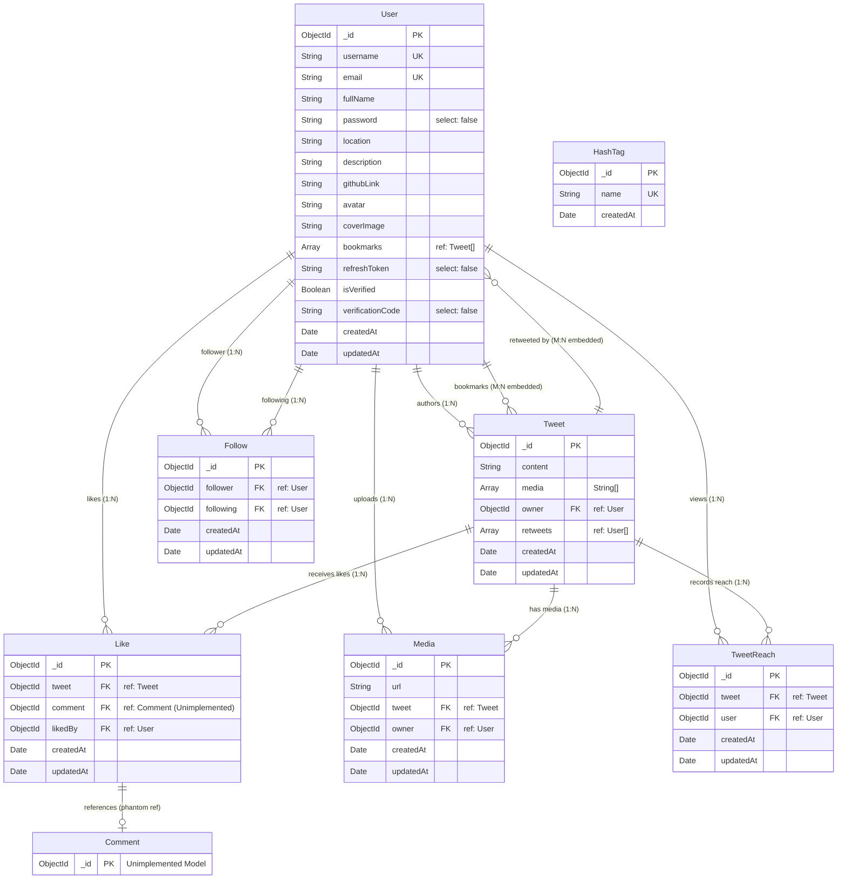
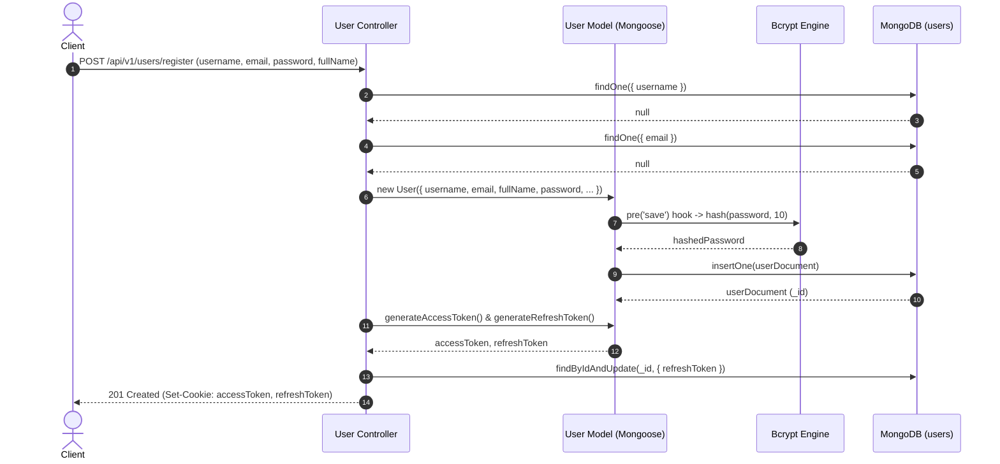
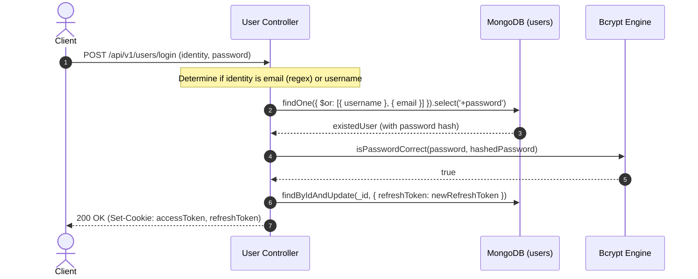
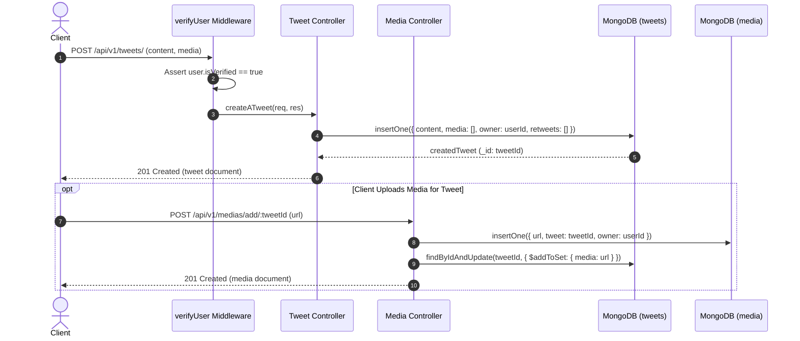
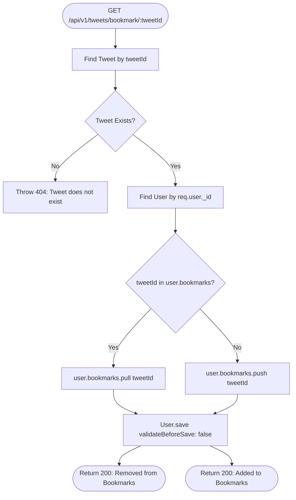
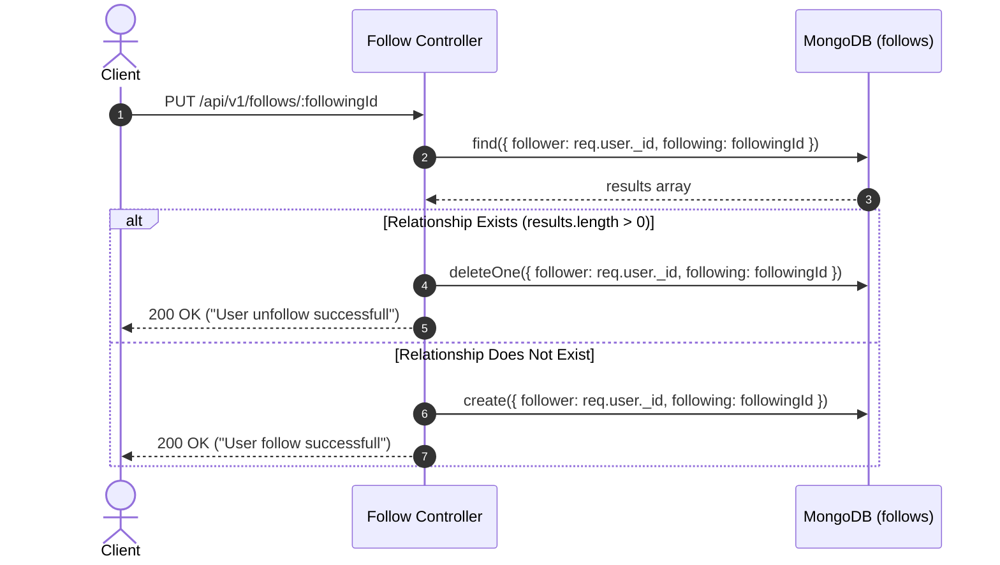
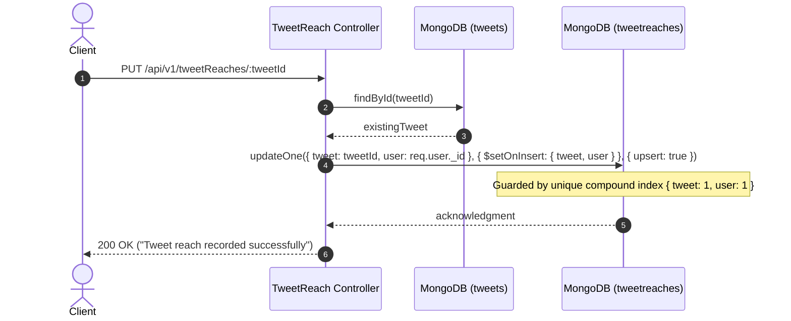
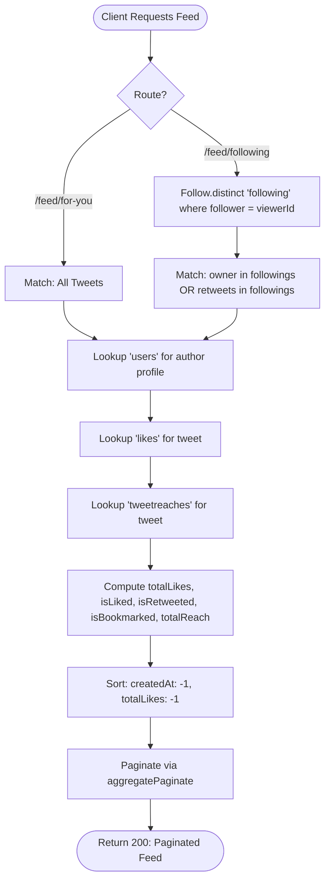

# Cwitter Database Architecture & Technical Specification

> **Project Name:** Cwitter (Twitter/X Full-Stack Clone Backend)  
> **System Architecture:** Model-View-Controller (MVC) / MERN Stack  
> **Database Engine:** MongoDB with Mongoose ODM 

---

## Table of Contents

1. [Project Database Overview](#1-project-database-overview)
2. [Technology Stack](#2-technology-stack)
3. [Database Architecture & Design Approach](#3-database-architecture--design-approach)
4. [Collection Overview](#4-collection-overview)
5. [Detailed Collection Schemas](#5-detailed-collection-schemas)
   - [5.1 Users Collection (`users`)](#51-users-collection-users)
   - [5.2 Tweets Collection (`tweets`)](#52-tweets-collection-tweets)
   - [5.3 Follows Collection (`follows`)](#53-follows-collection-follows)
   - [5.4 Likes Collection (`likes`)](#54-likes-collection-likes)
   - [5.5 Media Collection (`media`)](#55-media-collection-media)
   - [5.6 Tweet Reaches Collection (`tweetreaches`)](#56-tweet-reaches-collection-tweetreaches)
   - [5.7 HashTags Collection (`hashtags` - Draft/Inactive)](#57-hashtags-collection-hashtags---draftinactive)
6. [Entity Relationship Diagram (ERD)](#6-entity-relationship-diagram-erd)
7. [Collection Relationships](#7-collection-relationships)
8. [Aggregation Pipelines & Database Operations](#8-aggregation-pipelines--database-operations)
   - [8.1 "For You" Global Feed Aggregation](#81-for-you-global-feed-aggregation)
   - [8.2 "Following" Personalized Timeline Aggregation](#82-following-personalized-timeline-aggregation)
   - [8.3 Single Tweet Context Aggregation](#83-single-tweet-context-aggregation)
   - [8.4 User Profile Tweets Aggregation](#84-user-profile-tweets-aggregation)
   - [8.5 User Dashboard & Social Graph Statistics](#85-user-dashboard--social-graph-statistics)
   - [8.6 Followers & Following with Mutual Follow Detection](#86-followers--following-with-mutual-follow-detection)
   - [8.7 User Liked Tweets Feed with Root Replacement](#87-user-liked-tweets-feed-with-root-replacement)
   - [8.8 User Bookmarks Retrieval & Pipeline Audit](#88-user-bookmarks-retrieval--pipeline-audit)
   - [8.9 User Media Gallery Pipeline](#89-user-media-gallery-pipeline)
   - [8.10 User Search Pipeline with Sanitized Regex](#810-user-search-pipeline-with-sanitized-regex)
   - [8.11 Idempotent Reach Tracking with Upsert](#811-idempotent-reach-tracking-with-upsert)
   - [8.12 Hashtags and Personalization Status](#812-hashtags-and-personalization-status)
9. [Database Workflows](#9-database-workflows)
   - [9.1 User Registration & Token Generation](#91-user-registration--token-generation)
   - [9.2 Email Verification Lifecycle](#92-email-verification-lifecycle)
   - [9.3 User Authentication & Login](#93-user-authentication--login)
   - [9.4 Tweet Publication & Media Association](#94-tweet-publication--media-association)
   - [9.5 Like & Unlike Toggle](#95-like--unlike-toggle)
   - [9.6 Retweet & Undo Retweet](#96-retweet--undo-retweet)
   - [9.7 Bookmark & Remove Bookmark](#97-bookmark--remove-bookmark)
   - [9.8 Follow & Unfollow Network Graph](#98-follow--unfollow-network-graph)
   - [9.9 Idempotent Tweet Reach Tracking](#99-idempotent-tweet-reach-tracking)
   - [9.10 Dynamic Feed Assembly](#910-dynamic-feed-assembly)
10. [Data Integrity and Security](#10-data-integrity-and-security)
11. [Indexing and Performance](#11-indexing-and-performance)
12. [Data Lifecycle and Deletion Strategies](#12-data-lifecycle-and-deletion-strategies)
13. [Codebase Inconsistencies & Implementation Audit](#13-codebase-inconsistencies--implementation-audit)
14. [Future Database Improvements](#14-future-database-improvements)
15. [Conclusion](#15-conclusion)

---

## 1. Project Database Overview

**Cwitter** is a production-style, microblogging social media platform modeled after Twitter/X. The backend is engineered to handle dynamic social graph interactions, content broadcasting, multi-tiered engagement states, multimedia associations, and fine-grained view metrics while preserving user security and sub-second query latency.

At the heart of Cwitter lies a document-oriented database architecture built on **MongoDB**, interfaced through **Mongoose ODM**. Unlike traditional monolithic relational systems where rigid joins introduce latency bottlenecks at scale, Cwitter leverages a **hybrid document model**:
- **Normalized relational references** are deployed for high-volume, independently mutating entities such as social relationships (`Follow`), content interactions (`Like`), and impressions (`TweetReach`).
- **Strategic denormalization and embedded arrays** are deployed where data cohesion, read performance, and atomic membership lookups offer demonstrable latency benefits (e.g., embedded user bookmarks, retweet actor arrays, and cached tweet media URLs).

### Core Database Responsibilities
1. **Identity & Session Management:** Securing user credentials via bcrypt hashing, dual-token JWT storage, email verification state, and cryptographic password recovery.
2. **Social Graph Topology:** Bidirectional follow/follower graphs capable of calculating real-time follow status and mutual connections via self-referential aggregation.
3. **Content Publishing & Syndication:** High-throughput authoring of text and multimedia tweets, supporting edit histories, deletions, and hierarchical feed generation.
4. **Interaction & Engagement Tracking:** Handling likes, retweets, and bookmarks with duplicate prevention and real-time counter synthesis.
5. **Impression & Reach Analytics:** Tracking unique tweet impressions per user without write collisions using atomic upsert operations guarded by compound unique indexes.
6. **Paginated Data Streaming:** Standardized cursor-like aggregation pagination powered by `mongoose-aggregate-paginate-v2` across all major feeds and lists.

---

## 2. Technology Stack

| Layer | Component | Version / Specification | Role in System Architecture |
| :--- | :--- | :--- | :--- |
| **Database Engine** | MongoDB | `>= 6.0` (Community / Atlas) | Document-oriented NoSQL persistence store |
| **ODM Layer** | Mongoose | `^8.19.1` | Schema definition, validation, hooks, and query compilation |
| **Pagination Engine**| `mongoose-aggregate-paginate-v2` | `^1.1.5` | Standardized aggregate pipeline pagination |
| **Password Hashing** | `bcrypt` | `^6.0.0` | One-way adaptive hashing with 10 salt rounds |
| **Token Security** | `jsonwebtoken` | `^9.0.3` | Dual-token authentication (short-lived access, long-lived refresh) |
| **CSPRNG Utilities** | Node.js native `crypto` | Built-in | Cryptographic 6-digit codes and random URL-safe reset tokens |
| **CDN & Media Auth** | `@imagekit/nodejs` | `^7.10.0` | Server-side signature generation for direct client uploads |
| **Cloud Media** | `cloudinary` | `^2.7.0` | Media processing and auxiliary cloud asset management |
| **Server Framework** | Express | `^5.1.0` | Routing layer and middleware execution harness |
| **Execution Engine** | Node.js (ES Modules) | `>= 18.0.0` | Asynchronous I/O JavaScript runtime (`type: module`) |

---

## 3. Database Architecture & Design Approach

The Cwitter data tier adopts a **Domain-Driven Hybrid Architecture** balancing document embedding and relational referencing based on access patterns and write volatility:

```
+-------------------------------------------------------------------------------------------------+
|                                    Cwitter Database Architecture                                |
+-------------------------------------------------------------------------------------------------+
|                                                                                                 |
|   +-----------------------+                    1:N                     +--------------------+   |
|   |         users         | -----------------------------------------> |       tweets       |   |
|   |   (Profile, Auth,     |                                            |  (Posts, Content,  |   |
|   |  Embedded Bookmarks)  | < - - - - - - - - - - - - - - - - - - - -  | Embedded Retweets) |   |
|   +-----------------------+            Bookmarks (Tweet IDs)           +--------------------+   |
|             |          |                                                         |              |
|   Follower  |          | Following                                      Attached | 1:N          |
|      (1:N)  |          |   (1:N)                                        to Tweet |              |
|             v          v                                                         v              |
|   +-----------------------+     1:N      +--------------------+     1:N    +----------------+   |
|   |        follows        |              |       likes        | <--------- |     media      |   |
|   | (Adjacency List Node) |              | (Junction Record)  |            |  (Asset Index) |   |
|   +-----------------------+              +--------------------+            +----------------+   |
|                                                    |                                            |
|                                       Liked By     |                                            |
|                                         User       | 1:N                                        |
|                                                    v                                            |
|                                          +--------------------+                                 |
|                                          |    tweetreaches    |                                 |
|                                          | (Impression Index) |                                 |
|                                          +--------------------+                                 |
+-------------------------------------------------------------------------------------------------+
```

### Architectural Decisions & Trade-off Analysis

#### 1. Embedded Retweets Array vs. Dedicated Retweet Collection
- **Implementation:** `retweets: [{ type: Schema.Types.ObjectId, ref: "User" }]` embedded directly inside each `Tweet` document.
- **Rationale:** Microblogging retweets act as binary endorsement signals and distribution flags. Embedding user ObjectIds inside the tweet eliminates an external collection lookup during feed filtering (`$match: { $or: [{ owner: { $in: followings } }, { retweets: { $in: followings } }] }`). 
- **Constraint Consideration:** Because MongoDB documents have a 16MB BSON hard ceiling, storing millions of retweets in an array would risk unbounded document growth. In Cwitter's current scale, this provides fast access with zero-join reads.

#### 2. Independent Junction Collection for Likes (`likes`)
- **Implementation:** Distinct `Like` documents referencing `{ tweet: ObjectId, likedBy: ObjectId }`.
- **Rationale:** Unlike retweets, likes exhibit high write frequency, individual timestamps, and frequent querying of a user's liked history (`getUserLikedTweets`). Storing likes in a separate collection prevents write-lock contention on popular tweets, eliminates document size growth, and allows sorting directly by `createdAt` of the like interaction.

#### 3. Embedded Bookmarks on User vs. Dedicated Bookmark Collection
- **Implementation:** `bookmarks: [{ type: Schema.Types.ObjectId, ref: "Tweet" }]` embedded in `User`.
- **Rationale:** Bookmarks represent strictly private, user-specific data never rendered in public aggregate counts on tweets. Embedding them on the `User` document ensures that whenever an authenticated session loads the user profile, the user's saved list is immediately accessible in the user context without querying external tables.

#### 4. Dual Strategy for Media (`Media` Collection + `Tweet.media` URL Array)
- **Implementation:** Detailed records are stored in `media` (`url`, `tweet`, `owner`), while an array of raw strings (`media: [String]`) is maintained on the `Tweet` document.
- **Rationale:** Allows client timelines to display media URLs directly from the tweet document without performing an expensive `$lookup` against `media` on every feed load. Concurrently, the independent `media` collection permits efficient media gallery queries by user (`getUserMedia`) with ownership verification.

#### 5. Independent Impression Tracking (`tweetreaches`)
- **Implementation:** Distinct `TweetReach` collection pairing `{ tweet: ObjectId, user: ObjectId }` guarded by a compound unique index.
- **Rationale:** Views/impressions are the highest-frequency write event in social media. Storing views in an independent collection with atomic upsert operations (`$setOnInsert`) isolates impression traffic from content mutation locks and prevents duplicate counting per user.

---

## 4. Collection Overview

The backend registers 7 Mongoose models, mapping to the following MongoDB collections:

| Collection Name | Model Name | Primary Responsibility | Cardinality & Interactivity |
| :--- | :--- | :--- | :--- |
| `users` | `User` | User identity, credentials, profile metadata, verification codes, embedded bookmarks | Root entity; references tweets via embedded bookmarks array |
| `tweets` | `Tweet` | Post content, ownership, embedded media URLs, embedded retweeter IDs | Child of `users`; parent to `likes`, `media`, and `tweetreaches` |
| `follows` | `Follow` | Directed graph edge representing social following relationship | Junction collection linking two `users` (`follower` & `following`) |
| `likes` | `Like` | Granular record of a like interaction on a tweet | Junction collection linking a `users` document to a `tweets` document |
| `media` | `Media` | Metadata catalog for uploaded images and assets tied to tweets | Child of `users` (uploader) and `tweets` (associated post) |
| `tweetreaches`| `TweetReach` | Unique view/impression record per user per tweet | Junction collection linking `tweets` and `users` with unique constraint |
| `hashtags` | `HashTag` | Tag catalog for categorization (Draft/Inactive in codebase) | Isolated collection; not currently linked to active pipelines |

---

## 5. Detailed Collection Schemas

### 5.1 Users Collection (`users`)

The `users` collection stores authentication credentials, profile personalization attributes, account status flags, security tokens, and user-specific bookmarks.

#### Mongoose Schema Definition Table

| Field Name | BSON Type | Required | Default Value | Constraints & Validation | Relational Reference | Description |
| :--- | :--- | :--- | :--- | :--- | :--- | :--- |
| `_id` | `ObjectId` | Auto | Generated | Unique primary identifier | None | MongoDB primary key |
| `username` | `String` | Yes | None | `unique: true`, `index: true`, `trim: true`, `lowercase: true` | None | Unique platform handle (e.g. `@johndoe`) |
| `email` | `String` | Yes | None | `unique: true`, `index: true`, `trim: true`, `lowercase: true` | None | Primary communication and login address |
| `fullName` | `String` | Yes | None | `trim: true` | None | User's public display name |
| `password` | `String` | Yes | None | `select: false` | None | Bcrypt-hashed password string |
| `location` | `String` | No | `undefined` | Free-form text | None | Geographic location string |
| `description` | `String` | No | `undefined` | Free-form text | None | Public biography/about section |
| `githubLink` | `String` | No | `undefined` | Free-form URL | None | External GitHub profile link |
| `avatar` | `String` | No | `undefined` | CDN URL | None | ImageKit/Cloudinary avatar asset URL |
| `coverImage` | `String` | No | `undefined` | CDN URL | None | ImageKit/Cloudinary banner asset URL |
| `bookmarks` | `Array` | No | `[]` | Array of ObjectIds | `ref: "Tweet"` | Embedded list of saved tweet ObjectIds |
| `refreshToken`| `String` | No | `undefined` | `select: false` | None | Active JWT refresh token for session renewal |
| `isVerified` | `Boolean` | No | `false` | Boolean flag | None | Email verification status |
| `verificationCode`| `String`| No | `undefined` | `select: false` | None | 6-digit numeric CSPRNG code for email verification |
| `createdAt` | `Date` | Auto | Generated | Managed by `{ timestamps: true }` | None | Document creation timestamp |
| `updatedAt` | `Date` | Auto | Generated | Managed by `{ timestamps: true }` | None | Document last update timestamp |

#### Schema Hooks, Methods & Plugins
- **Pre-Save Middleware (`userSchema.pre("save")`):** Inspects password modification using `this.isModified("password")`. If modified, hashes password with `bcrypt.hash(this.password, 10)` prior to storage.
- **Instance Method `isPasswordCorrect(password)`:** Asynchronously compares plaintext candidate string against the hashed password using `bcrypt.compare`.
- **Instance Method `generateAccessToken()`:** Generates a signed JWT containing `{ _id, username, email }` utilizing `ACCESS_TOKEN_SECRET_KEY` with expiration set by `ACCESS_TOKEN_EXPIRE_TIME`.
- **Instance Method `generateRefreshToken()`:** Generates a signed JWT containing `{ _id, username, email }` utilizing `REFRESH_TOKEN_SECRET_KEY` with expiration set by `REFRESH_TOKEN_EXPIRE_TIME`.
- **Plugins:** `userSchema.plugin(aggregatePaginate)` enabling pagination on aggregate pipelines.

#### Representative Document Example
```json
{
  "_id": { "$oid": "66d01a2b3c4d5e6f7a8b9c01" },
  "username": "aparneet_dev",
  "email": "aparneet@example.com",
  "fullName": "Aparneet Dey",
  "location": "Kolkata, India",
  "description": "Full Stack Engineer & MERN Specialist",
  "githubLink": "https://github.com/AparneetDey",
  "avatar": "https://ik.imagekit.io/cwitter/avatars/avatar_66d01a2b.png",
  "coverImage": "https://ik.imagekit.io/cwitter/covers/cover_66d01a2b.jpg",
  "bookmarks": [
    { "$oid": "66d02f5a3c4d5e6f7a8b9d10" },
    { "$oid": "66d03a1b3c4d5e6f7a8b9d25" }
  ],
  "isVerified": true,
  "createdAt": { "$date": "2026-08-15T10:00:00.000Z" },
  "updatedAt": { "$date": "2026-08-20T14:30:00.000Z" },
  "__v": 2
}
```

---

### 5.2 Tweets Collection (`tweets`)

The `tweets` collection stores core user-generated posts, author references, denormalized media URLs, and embedded lists of retweeting users.

#### Mongoose Schema Definition Table

| Field Name | BSON Type | Required | Default Value | Constraints & Validation | Relational Reference | Description |
| :--- | :--- | :--- | :--- | :--- | :--- | :--- |
| `_id` | `ObjectId` | Auto | Generated | Unique primary identifier | None | MongoDB primary key |
| `content` | `String` | Yes | None | Non-empty string | None | Primary text payload of the tweet |
| `media` | `Array` | No | `[]` | Array of String URLs | None | Denormalized URLs of attached media assets |
| `owner` | `ObjectId` | Yes | None | Valid user reference | `ref: "User"` | Foreign reference to authoring user |
| `retweets` | `Array` | No | `[]` | Array of ObjectIds | `ref: "User"` | Embedded array of users who retweeted this post |
| `createdAt` | `Date` | Auto | Generated | Managed by `{ timestamps: true }` | None | Publication timestamp |
| `updatedAt` | `Date` | Auto | Generated | Managed by `{ timestamps: true }` | None | Last edit timestamp |

#### Schema Hooks, Methods & Plugins
- **Instance Method `isOwner(userId)`:** Evaluates ownership by executing `this.owner.equals(userId)`.
- **Plugins:** `tweetSchema.plugin(aggregatePaginate)` enabling pagination over complex timeline pipelines.

#### Representative Document Example
```json
{
  "_id": { "$oid": "66d02f5a3c4d5e6f7a8b9d10" },
  "content": "Excited to share the complete MongoDB database documentation for Cwitter! #MERN #MongoDB",
  "media": [
    "https://ik.imagekit.io/cwitter/tweets/architecture-diagram-1.png",
    "https://ik.imagekit.io/cwitter/tweets/er-model-preview.png"
  ],
  "owner": { "$oid": "66d01a2b3c4d5e6f7a8b9c01" },
  "retweets": [
    { "$oid": "66d01b9e3c4d5e6f7a8b9c02" },
    { "$oid": "66d01c1f3c4d5e6f7a8b9c03" }
  ],
  "createdAt": { "$date": "2026-08-16T12:00:00.000Z" },
  "updatedAt": { "$date": "2026-08-16T12:05:00.000Z" },
  "__v": 2
}
```

---

### 5.3 Follows Collection (`follows`)

The `follows` collection models a directed social graph edge indicating that one user (`follower`) follows another user (`following`).

#### Mongoose Schema Definition Table

| Field Name | BSON Type | Required | Default Value | Constraints & Validation | Relational Reference | Description |
| :--- | :--- | :--- | :--- | :--- | :--- | :--- |
| `_id` | `ObjectId` | Auto | Generated | Unique primary identifier | None | MongoDB primary key |
| `follower` | `ObjectId` | Yes* | None | Valid user ObjectId | `ref: "User"` | User initiating the follow relationship |
| `following`| `ObjectId` | Yes* | None | Valid user ObjectId | `ref: "User"` | User being followed |
| `createdAt` | `Date` | Auto | Generated | Managed by `{ timestamps: true }` | None | Relationship creation timestamp |
| `updatedAt` | `Date` | Auto | Generated | Managed by `{ timestamps: true }` | None | Relationship update timestamp |

> **Implementation Note:** Schema definition uses `require: true` (a JavaScript typo for Mongoose's standard `required: true`). Controller logic explicitly verifies presence before invocation (`if(!followingId) throw new ApiError(...)`).

#### Schema Hooks, Methods & Plugins
- **Plugins:** `followSchema.plugin(aggregatePaginate)` supporting paginated follower/following listings.

#### Representative Document Example
```json
{
  "_id": { "$oid": "66d04e123c4d5e6f7a8b9e01" },
  "follower": { "$oid": "66d01b9e3c4d5e6f7a8b9c02" },
  "following": { "$oid": "66d01a2b3c4d5e6f7a8b9c01" },
  "createdAt": { "$date": "2026-08-17T08:15:30.000Z" },
  "updatedAt": { "$date": "2026-08-17T08:15:30.000Z" },
  "__v": 0
}
```

---

### 5.4 Likes Collection (`likes`)

The `likes` collection acts as a normalized junction recording like endorsements on tweets.

#### Mongoose Schema Definition Table

| Field Name | BSON Type | Required | Default Value | Constraints & Validation | Relational Reference | Description |
| :--- | :--- | :--- | :--- | :--- | :--- | :--- |
| `_id` | `ObjectId` | Auto | Generated | Unique primary identifier | None | MongoDB primary key |
| `tweet` | `ObjectId` | No | `undefined` | Optional post reference | `ref: "Tweet"` | Liked tweet reference |
| `comment` | `ObjectId` | No | `undefined` | Optional comment reference | `ref: "Comment"` | Phantom ref (Comment collection not present) |
| `likedBy` | `ObjectId` | Yes* | None | Valid user reference | `ref: "User"` | User who initiated the like |
| `createdAt` | `Date` | Auto | Generated | Managed by `{ timestamps: true }` | None | Timestamp when like occurred |
| `updatedAt` | `Date` | Auto | Generated | Managed by `{ timestamps: true }` | None | Update timestamp |

> **Implementation Note:** Like `follow.model.js`, `likedBy` utilizes `require: true`. The `comment` field exists in the schema definition, but no corresponding `Comment` model, route, or controller is present in the codebase.

#### Schema Hooks, Methods & Plugins
- **Plugins:** `likeSchema.plugin(aggregatePaginate)` supporting paginated user like histories.

#### Representative Document Example
```json
{
  "_id": { "$oid": "66d05f333c4d5e6f7a8b9f12" },
  "tweet": { "$oid": "66d02f5a3c4d5e6f7a8b9d10" },
  "likedBy": { "$oid": "66d01b9e3c4d5e6f7a8b9c02" },
  "createdAt": { "$date": "2026-08-17T09:00:00.000Z" },
  "updatedAt": { "$date": "2026-08-17T09:00:00.000Z" },
  "__v": 0
}
```

---

### 5.5 Media Collection (`media`)

The `media` collection maintains an asset registry linking uploaded CDN URLs to their parent tweet and uploading author.

#### Mongoose Schema Definition Table

| Field Name | BSON Type | Required | Default Value | Constraints & Validation | Relational Reference | Description |
| :--- | :--- | :--- | :--- | :--- | :--- | :--- |
| `_id` | `ObjectId` | Auto | Generated | Unique primary identifier | None | MongoDB primary key |
| `url` | `String` | Yes* | None | Valid URL string | None | Remote CDN hosting URL |
| `tweet` | `ObjectId` | Yes* | None | Valid tweet reference | `ref: "Tweet"` | Target tweet associated with this asset |
| `owner` | `ObjectId` | Yes* | None | Valid user reference | `ref: "User"` | Author who uploaded the media |
| `createdAt` | `Date` | Auto | Generated | Managed by `{ timestamps: true }` | None | Upload timestamp |
| `updatedAt` | `Date` | Auto | Generated | Managed by `{ timestamps: true }` | None | Record update timestamp |

#### Schema Hooks, Methods & Plugins
- **Instance Method `isOwner(userId)`:** Executes `this.owner.equals(userId)` to enforce authorization on asset deletion.
- **Plugins:** `mediaSchema.plugin(aggregatePaginate)` supporting paginated user media galleries.

#### Representative Document Example
```json
{
  "_id": { "$oid": "66d06a443c4d5e6f7a8ba001" },
  "url": "https://ik.imagekit.io/cwitter/tweets/architecture-diagram-1.png",
  "tweet": { "$oid": "66d02f5a3c4d5e6f7a8b9d10" },
  "owner": { "$oid": "66d01a2b3c4d5e6f7a8b9c01" },
  "createdAt": { "$date": "2026-08-16T12:02:00.000Z" },
  "updatedAt": { "$date": "2026-08-16T12:02:00.000Z" },
  "__v": 0
}
```

---

### 5.6 Tweet Reaches Collection (`tweetreaches`)

The `tweetreaches` collection tracks unique view impressions per tweet per authenticated user.

#### Mongoose Schema Definition Table

| Field Name | BSON Type | Required | Default Value | Constraints & Validation | Relational Reference | Description |
| :--- | :--- | :--- | :--- | :--- | :--- | :--- |
| `_id` | `ObjectId` | Auto | Generated | Unique primary identifier | None | MongoDB primary key |
| `tweet` | `ObjectId` | Yes | None | Valid tweet reference | `ref: "Tweet"` | Tweet being viewed |
| `user` | `ObjectId` | Yes | None | Valid user reference | `ref: "User"` | Viewer contributing to reach count |
| `createdAt` | `Date` | Auto | Generated | Managed by `{ timestamps: true }` | None | First impression timestamp |
| `updatedAt` | `Date` | Auto | Generated | Managed by `{ timestamps: true }` | None | Last update timestamp |

#### Indexes
- **Compound Unique Index:** `tweetReachSchema.index({ tweet: 1, user: 1 }, { unique: true })`
  - **Purpose:** Enforces at the database engine level that an individual user can register an impression on a specific tweet exactly once. Enables idempotent atomic upsert updates (`$setOnInsert`).

#### Representative Document Example
```json
{
  "_id": { "$oid": "66d07b883c4d5e6f7a8ba155" },
  "tweet": { "$oid": "66d02f5a3c4d5e6f7a8b9d10" },
  "user": { "$oid": "66d01b9e3c4d5e6f7a8b9c02" },
  "createdAt": { "$date": "2026-08-16T12:10:00.000Z" },
  "updatedAt": { "$date": "2026-08-16T12:10:00.000Z" },
  "__v": 0
}
```

---

### 5.7 HashTags Collection (`hashtags` - Draft/Inactive)

The `hashtags` collection schema exists in the codebase but remains inactive and unmounted in the route hierarchy.

#### Mongoose Schema Definition Table

| Field Name | BSON Type | Required | Default Value | Constraints & Validation | Relational Reference | Description |
| :--- | :--- | :--- | :--- | :--- | :--- | :--- |
| `_id` | `ObjectId` | Auto | Generated | Unique primary identifier | None | MongoDB primary key |
| `name` | `String` | Yes | None | `unique: true` | None | Tag name / label |
| `createdAt` | `Date` | No | `Date.now` | Default timestamp | None | Tag discovery timestamp |

> **Architectural & Codebase Finding:** In `backend/src/models/hashTag.model.js`, `model` is invoked without importing it from `mongoose` (`import {Schema} from 'mongoose'`). The controller `backend/src/controllers/hashTag.controller.js` is an empty stub, and no hashtag router is registered in `backend/src/app.js`.

#### Representative Document Example (Intended Schema)
```json
{
  "_id": { "$oid": "66d08c993c4d5e6f7a8ba299" },
  "name": "MongoDB",
  "createdAt": { "$date": "2026-08-16T12:00:00.000Z" }
}
```

---

## 6. Entity Relationship Diagram (ERD)

The following Mermaid ER Diagram models all verified collections, fields, primary/foreign keys, cardinality, and embedded relationships:



---

## 7. Collection Relationships

### Comprehensive Relational Catalog

| Source Collection | Target Collection | Referencing Key | Relationship Type | Maintenance Mechanism | Deletion Effect (Cascade/Orphan) | Resolution Mechanism |
| :--- | :--- | :--- | :--- | :--- | :--- | :--- |
| `tweets` | `users` | `owner` | One-to-Many (Author) | Mongoose Model instantiation | User deletion not implemented; orphaned tweets possible | Resolved via Aggregation `$lookup` |
| `users` | `tweets` | `bookmarks` | Many-to-Many (Embedded) | Controller `push`/`pull` & `$pull` | Cascading pull in `deleteATweet` cleans up bookmarks | Resolved via Aggregation `$unwind` + `$lookup` |
| `tweets` | `users` | `retweets` | Many-to-Many (Embedded) | Controller `$addToSet`/`$pull` | Unhandled on User deletion; remains in array | Evaluated inline with `$size` and `$in` |
| `follows` | `users` | `follower` | Many-to-Many (Junction) | Controller `create`/`deleteOne` | Unhandled; orphaned edges if user deleted | Resolved via Aggregation `$lookup` |
| `follows` | `users` | `following` | Many-to-Many (Junction) | Controller `create`/`deleteOne` | Unhandled; orphaned edges if user deleted | Resolved via Aggregation `$lookup` |
| `likes` | `tweets` | `tweet` | Many-to-Many (Junction) | Controller `create`/`deleteOne` | **Orphaned:** `deleteATweet` does NOT clean up `likes` | Resolved via Aggregation `$lookup` |
| `likes` | `users` | `likedBy` | Many-to-Many (Junction) | Controller `create`/`deleteOne` | Unhandled on user deletion | Resolved via Aggregation `$lookup` |
| `media` | `tweets` | `tweet` | One-to-Many (Child Asset)| Controller `create`/`deleteOne` | **Cascaded:** `deleteATweet` executes `Media.deleteMany` | Resolved via Aggregation `$lookup` |
| `media` | `users` | `owner` | One-to-Many (Uploader) | Controller `create` | Unhandled on user deletion | Resolved via Aggregation `$lookup` |
| `tweetreaches`| `tweets` | `tweet` | Many-to-Many (Junction) | Controller atomic `updateOne` | **Orphaned:** `deleteATweet` does NOT clean up `tweetreaches`| Resolved via Aggregation `$lookup` |
| `tweetreaches`| `users` | `user` | Many-to-Many (Junction) | Controller atomic `updateOne` | Unhandled on user deletion | Resolved via Aggregation `$lookup` |
| `likes` | `comments` | `comment` | One-to-Many (Phantom) | Not implemented | Target collection does not exist | None |

---

## 8. Aggregation Pipelines & Database Operations

Cwitter relies heavily on multi-stage MongoDB aggregation pipelines rather than simple queries or Mongoose `.populate()`. Aggregations allow the server to offload relational joins, conditional computations (`$in`, `$map`), dynamic count resolutions (`$size`), and complex sorting down to the database engine.

---

### 8.1 "For You" Global Feed Aggregation
- **Controller Method:** `getUserFeed` (`backend/src/controllers/tweet.controller.js`)
- **Route:** `GET /api/v1/tweets/feed/for-you`
- **Collections Involved:** `tweets` (root), `users`, `likes`, `tweetreaches`.
- **Purpose:** Compiles a globally engaged feed for all users, dynamically computing viewer interaction states and ranking by recency and like engagement.

#### Aggregation Pipeline Breakdown
```javascript
[
  // Stage 1: Join author profile details from users collection
  {
    $lookup: {
      from: "users",
      localField: "owner",
      foreignField: "_id",
      as: "owner",
      pipeline: [
        {
          $project: {
            username: 1,
            fullName: 1,
            avatar: 1,
            isVerified: 1
          }
        }
      ]
    }
  },
  // Stage 2: Join all like records for the tweet
  {
    $lookup: {
      from: "likes",
      localField: "_id",
      foreignField: "tweet",
      as: "tweetLikes",
      pipeline: [
        {
          $project: {
            _id: 0,
            likedBy: 1
          }
        }
      ]
    }
  },
  // Stage 3: Join impression reach records
  {
    $lookup: {
      from: "tweetreaches",
      localField: "_id",
      foreignField: "tweet",
      as: "reachData"
    }
  },
  // Stage 4: Transform tweetLikes into an array of user ObjectIds
  {
    $addFields: {
      likes: {
        $map: {
          input: "$tweetLikes",
          as: "like",
          in: "$$like.likedBy"
        }
      }
    }
  },
  // Stage 5: Compute engagement counts and viewer-specific interaction flags
  {
    $addFields: {
      totalRetweets: { $size: "$retweets" },
      isRetweeted: { $in: [req.user._id, "$retweets"] },
      owner: { $first: "$owner" },
      isBookmarked: { $in: ["$_id", req.user.bookmarks] },
      totalLikes: { $size: "$likes" },
      isLiked: { $in: [req.user._id, "$likes"] },
      totalReach: { $size: "$reachData" }
    }
  },
  // Stage 6: Multi-tier engagement sort (Newest first, then most liked)
  {
    $sort: {
      createdAt: -1,
      totalLikes: -1
    }
  },
  // Stage 7: Strip intermediate join arrays to reduce network payload
  {
    $project: {
      retweets: 0,
      tweetLikes: 0,
      likes: 0,
      reachData: 0
    }
  }
]
```

---

### 8.2 "Following" Personalized Timeline Aggregation
- **Controller Method:** `getUserFollowingFeed` (`backend/src/controllers/tweet.controller.js`)
- **Route:** `GET /api/v1/tweets/feed/following`
- **Collections Involved:** `follows`, `tweets` (root), `users`, `likes`, `tweetreaches`.
- **Purpose:** Generates a personalized timeline consisting strictly of content generated or retweeted by users whom the authenticated requester follows.

#### Execution Mechanics
1. **Pre-Query ID Extraction:** Queries the `follows` collection using `distinct`:
   ```javascript
   const followings = await Follow.distinct("following", { follower: req.user._id });
   ```
2. **Aggregation Pipeline Execution:** Executes the pipeline using `$or` to capture direct tweets and retweets:
   ```javascript
   [
     {
       $match: {
         $or: [
           { owner: { $in: followings } },
           { retweets: { $in: followings } }
         ]
       }
     },
     // Identical lookup, metric computation, and sorting stages as 8.1
     ...
   ]
   ```

---

### 8.3 Single Tweet Context Aggregation
- **Controller Method:** `getATweet` (`backend/src/controllers/tweet.controller.js`)
- **Route:** `GET /api/v1/tweets/:tweetId`
- **Collections Involved:** `tweets`, `users`, `likes`, `tweetreaches`.
- **Purpose:** Retrieves a single tweet by ID with author metadata, likes count, reach count, and boolean flags evaluating the requester's like, retweet, and bookmark state.
- **Pipeline:** Starts with `$match: { _id: new mongoose.Types.ObjectId(tweetId) }` followed by author `$lookup`, like `$lookup`, reach `$lookup`, metric calculation via `$addFields`, and projection.

---

### 8.4 User Profile Tweets Aggregation
- **Controller Method:** `getUserTweets` (`backend/src/controllers/tweet.controller.js`)
- **Route:** `GET /api/v1/tweets/user/:userId`
- **Collections Involved:** `tweets`, `users`, `likes`, `tweetreaches`.
- **Purpose:** Fetches all tweets authored by a specific user, sorted in descending chronological order (`$sort: { createdAt: -1 }`), enriched with viewer engagement status.
- **Pipeline:** Starts with `$match: { owner: new mongoose.Types.ObjectId(userId) }`, applies enrichment lookups, sorts by `createdAt: -1`, and executes through `Tweet.aggregatePaginate`.

---

### 8.5 User Dashboard & Social Graph Statistics
- **Controller Method:** `getUserDashboard` (`backend/src/controllers/user.controller.js`)
- **Route:** `GET /api/v1/users/dashboard/:userId`
- **Collections Involved:** `users` (root), `follows`.
- **Purpose:** Synthesizes profile metadata with computed follower counts, following counts, and relationship status relative to the authenticated requester.

#### Aggregation Pipeline Breakdown
```javascript
[
  {
    $match: {
      _id: new mongoose.Types.ObjectId(userId)
    }
  },
  // Inward edges: Followers
  {
    $lookup: {
      from: "follows",
      localField: "_id",
      foreignField: "following",
      as: "followers"
    }
  },
  // Outward edges: Following
  {
    $lookup: {
      from: "follows",
      localField: "_id",
      foreignField: "follower",
      as: "followings"
    }
  },
  // Calculate counts and viewer follow state
  {
    $addFields: {
      totalFollowers: { $size: "$followers" },
      totalFollowings: { $size: "$followings" },
      isFollowing: {
        $in: [
          new mongoose.Types.ObjectId(req.user._id),
          "$followers.follower"
        ]
      }
    }
  },
  // Mask sensitive and heavy arrays
  {
    $project: {
      followers: 0,
      followings: 0,
      password: 0,
      refreshToken: 0,
      bookmarks: 0
    }
  }
]
```

---

### 8.6 Followers & Following with Mutual Follow Detection
- **Controller Methods:** `getUserFollowers` & `getUserFollowings` (`backend/src/controllers/follow.controller.js`)
- **Routes:** `GET /api/v1/follows/followers/:userId` & `GET /api/v1/follows/followings/:userId`
- **Collections Involved:** `follows` (root), `users`, `follows` (self-join).
- **Purpose:** Returns paginated lists of followers/following while performing a correlated sub-pipeline lookup against `follows` to determine if the requesting viewer also follows each target user in the list.

#### Correlated Sub-Pipeline for Mutual Follow Check (`getUserFollowers`)
```javascript
[
  { $match: { following: new mongoose.Types.ObjectId(userId) } },
  {
    $lookup: {
      from: "users",
      localField: "follower",
      foreignField: "_id",
      as: "follower",
      pipeline: [{ $project: { _id: 1, username: 1, fullName: 1, avatar: 1, description: 1, isVerified: 1 } }]
    }
  },
  { $unwind: "$follower" },
  // Correlated self-join checking if viewer follows target user
  {
    $lookup: {
      from: "follows",
      let: { targetUserId: "$follower._id" },
      as: "followingBack",
      pipeline: [
        {
          $match: {
            $expr: {
              $and: [
                { $eq: ["$follower", new mongoose.Types.ObjectId(req.user._id)] },
                { $eq: ["$following", "$$targetUserId"] }
              ]
            }
          }
        }
      ]
    }
  },
  {
    $addFields: {
      isFollowing: { $gt: [{ $size: "$followingBack" }, 0] }
    }
  },
  {
    $project: {
      _id: "$follower._id",
      username: "$follower.username",
      fullName: "$follower.fullName",
      avatar: "$follower.avatar",
      description: "$follower.description",
      isVerified: "$follower.isVerified",
      isFollowing: 1
    }
  }
]
```

---

### 8.7 User Liked Tweets Feed with Root Replacement
- **Controller Method:** `getUserLikedTweets` (`backend/src/controllers/like.controller.js`)
- **Route:** `GET /api/v1/likes/user/:userId`
- **Collections Involved:** `likes` (root), `tweets`, `users`, `likes`, `tweetreaches`.
- **Purpose:** Fetches all tweets endorsed by a user, ordered by the time the like was placed, and uses `$replaceRoot` to reshape the stream into standard tweet documents.

#### Key Aggregation Mechanics
1. Matches likes by user: `$match: { likedBy: ObjectId(userId), tweet: { $exists: true, $type: "objectId" } }`.
2. Performs nested `$lookup` from `tweets`, joining tweet author, likes, and reach.
3. Sorts by `$sort: { createdAt: -1 }` (sorting on the like timestamp).
4. Flattens structure via `$replaceRoot: { newRoot: "$likedTweets" }`.
5. Paginates via `Like.aggregatePaginate`.

---

### 8.8 User Bookmarks Retrieval & Pipeline Audit
- **Controller Method:** `getUserBookmarks` (`backend/src/controllers/user.controller.js`)
- **Route:** `GET /api/v1/users/bookmarks`
- **Collections Involved:** `users` (root), `tweets`, `users` (author), `likes`, `tweetreaches`.
- **Purpose:** Unwinds user's saved bookmark IDs, joins tweet content, author details, and engagement metrics.

> **Critical Codebase Inconsistency Audit:**  
> In `backend/src/controllers/user.controller.js` (Lines 540-562), the pipeline contains a relational key bug:
> ```javascript
> // Existing Code in user.controller.js:
> {
>   $lookup: {
>     from: "likes",
>     localField: "_id",        // BUG: Refers to root User._id instead of "bookmark._id"
>     foreignField: "tweet",
>     as: "tweetLikes"
>   }
> },
> {
>   $lookup: {
>     from: "tweetreaches",
>     localField: "_id",        // BUG: Refers to root User._id instead of "bookmark._id"
>     foreignField: "tweet",
>     as: "reachData"
>   }
> }
> ```
> Because `_id` at the pipeline root represents the user requesting bookmarks, the join queries `likes` and `tweetreaches` where the `tweet` field matches the *User's ObjectId*, resulting in empty arrays for likes and reach on bookmarked tweets. The correct specification requires `localField: "bookmark._id"`.

---

### 8.9 User Media Gallery Pipeline
- **Controller Method:** `getUserMedia` (`backend/src/controllers/media.controller.js`)
- **Route:** `GET /api/v1/medias/user/:userId`
- **Collections Involved:** `media` (root), `tweets`, `users`.
- **Purpose:** Aggregates all uploaded media assets authored by a user, joining the parent tweet content and tweet author.
- **Pipeline:** Matches by `owner: ObjectId(userId)`, lookups `tweets` (`localField: "tweet"`), nests lookup for author details from `users`, sorts by `createdAt: -1`, and maps output to `{ _id, url, tweetId, tweet }`.

---

### 8.10 User Search Pipeline with Sanitized Regex
- **Controller Method:** `getSearchUsers` (`backend/src/controllers/user.controller.js`)
- **Route:** `GET /api/v1/users/search`
- **Collections Involved:** `users`.
- **Purpose:** Case-insensitive search across user display names and handles with regex character escaping.
- **Pipeline:** Sanitizes query via `searchQuery.replace(/[.*+?^${}()|[\]\\]/g, '\\$&')`, executes `$match: { $or: [{ fullName: { $regex: escapedQuery, $options: "i" } }, { username: { $regex: escapedQuery, $options: "i" } }] }`, and projects clean user cards with pagination.

---

### 8.11 Idempotent Reach Tracking with Upsert
- **Controller Method:** `recordTweetReach` (`backend/src/controllers/tweetReach.controller.js`)
- **Route:** `PUT /api/v1/tweetReaches/:tweetId`
- **Collections Involved:** `tweetreaches`, `tweets`.
- **Purpose:** Atomically records an impression for a user on a tweet without double counting.
- **Execution:**
  ```javascript
  await TweetReach.updateOne(
    { tweet: tweetId, user: req.user._id },
    { $setOnInsert: { tweet: existingTweet._id, user: req.user._id } },
    { upsert: true }
  );
  ```
  Guarded by compound unique index `{ tweet: 1, user: 1 }`, this ensures zero duplicate records and zero race-condition duplicates.

---

### 8.12 Hashtags and Personalization Status

| Feature Mentioned in Requirements | Status in Actual Codebase | Technical Verification & Evidence |
| :--- | :--- | :--- |
| **Hashtag Extraction** | **Not Implemented** | No parser exists in `tweet.controller.js` to scan `#` symbols from content. |
| **Trending Hashtags Calculation** | **Not Implemented** | `hashTag.controller.js` has 3 lines of imports; no route mounted in `app.js`. |
| **Category/Topic Personalization** | **Not Implemented** | `user.model.js` contains no interest arrays; timeline sorting is chronological and engagement-weighted. |

---

## 9. Database Workflows

---

### 9.1 User Registration & Token Generation



**Collections Impacted:**
- `users`: Checked (`findOne`), Created (`insertOne`), Updated (`refreshToken`).

---

### 9.2 Email Verification Lifecycle

```mermaid
flowchart TD
    Start([User Requests Verification]) --> CheckUser[Find User by req.user._id]
    CheckUser --> VerifiedCheck{Already Verified?}
    VerifiedCheck -- Yes --> Err400[Throw 400: Already Verified]
    VerifiedCheck -- No --> GenCode[Generate 6-digit Code via crypto.randomInt]
    GenCode --> SendMail[Dispatch Email via Nodemailer SMTP]
    SendMail --> SaveCode[Update user: verificationCode = code in users collection]
    SaveCode --> PromptClient[Return 200: Code Sent]

    PromptClient --> SubmitCode[User Submits Code via POST /verify-check]
    SubmitCode --> FetchCode[Find User .select('+verificationCode')]
    FetchCode --> Validate{Submitted Code == Stored Code?}
    Validate -- No --> Err401[Throw 401: Invalid Code]
    Validate -- Yes --> UpdateDB[Update user: isVerified = true, verificationCode = undefined]
    UpdateDB --> Done([Return 200: Verification Completed])
```

**Collections Impacted:**
- `users`: Read (`findById`), Updated (`verificationCode`, then `isVerified = true`).

---

### 9.3 User Authentication & Login



**Collections Impacted:**
- `users`: Read (`findOne`), Updated (`refreshToken`).

---

### 9.4 Tweet Publication & Media Association



**Collections Impacted:**
- `tweets`: Created (`insertOne`), Updated (`$addToSet` media).
- `media`: Created (`insertOne`).

---

### 9.5 Like & Unlike Toggle

```mermaid
flowchart TD
    Request([PUT /api/v1/likes/tweet/:tweetId]) --> CheckTweet[Find Tweet by tweetId]
    CheckTweet --> TweetExists{Tweet Exists?}
    TweetExists -- No --> Throw404[Throw 404: Tweet Not Found]
    TweetExists -- Yes --> CheckLike[Query likes: { tweet: tweetId, likedBy: userId }]
    CheckLike --> IsLiked{Record Found?}
    IsLiked -- Yes --> DeleteLike[Delete Record: Like.deleteOne]
    DeleteLike --> ResUnlike([Return 200: Tweet Unlike Successful])
    IsLiked -- No --> CreateLike[Insert Record: Like.create]
    CreateLike --> ResLike([Return 200: Tweet Like Successful])
```

**Collections Impacted:**
- `tweets`: Read (`findById`).
- `likes`: Read (`findOne`), Deleted (`deleteOne`) OR Created (`insertOne`).

---

### 9.6 Retweet & Undo Retweet

```mermaid
flowchart TD
    Request([GET /api/v1/tweets/retweet/:tweetId]) --> VerifyAuth[verifyUser Middleware: Assert isVerified]
    VerifyAuth --> FetchTweet[Find Tweet by tweetId]
    FetchTweet --> TweetExists{Tweet Exists?}
    TweetExists -- No --> Err404[Throw 404: Tweet does not exist]
    TweetExists -- Yes --> CheckArray{userId in tweet.retweets?}
    CheckArray -- Yes --> PullUser[Tweet.findByIdAndUpdate: $pull { retweets: userId }]
    PullUser --> ResUndo([Return 200: Retweet toggle successful - Removed])
    CheckArray -- No --> AddUser[Tweet.findByIdAndUpdate: $addToSet { retweets: userId }]
    AddUser --> ResAdd([Return 200: Retweet toggle successful - Added])
```

**Collections Impacted:**
- `tweets`: Read (`findById`), Updated (`$pull` or `$addToSet` in `retweets` array).

---

### 9.7 Bookmark & Remove Bookmark



**Collections Impacted:**
- `tweets`: Read (`findById`).
- `users`: Read (`findById`), Updated (`save()` with modified `bookmarks` array).

---

### 9.8 Follow & Unfollow Network Graph



**Collections Impacted:**
- `follows`: Read (`find`), Deleted (`deleteOne`) OR Created (`insertOne`).

---

### 9.9 Idempotent Tweet Reach Tracking



**Collections Impacted:**
- `tweets`: Read (`findById`).
- `tweetreaches`: Upserted (`updateOne` with `$setOnInsert` and `upsert: true`).

---

### 9.10 Dynamic Feed Assembly



**Collections Impacted:**
- `follows`: Read (`distinct`) for following feed.
- `tweets`: Root aggregation read.
- `users`: Read via `$lookup`.
- `likes`: Read via `$lookup`.
- `tweetreaches`: Read via `$lookup`.

---

## 10. Data Integrity and Security

### 1. Cryptographic Security & Password Hashing
- **Bcrypt Salt Rounds:** Configured with 10 salt rounds in `user.model.js`.
- **Pre-Save Automatic Hashing:** Intercepts `save` events and hashes passwords if `this.isModified("password")` is true.
- **Password Reset Security:** Temporary passwords are generated using `crypto.randomBytes(12).toString("base64url").slice(0, 16)`, sent via secure SMTP, and hashed upon saving to the database.

### 2. Information Hiding via Schema Projections
- Critical fields are protected with `select: false` in `user.model.js`:
  - `password`: Prevents accidental transmission in API responses.
  - `refreshToken`: Shielded from query projections to prevent session interception.
  - `verificationCode`: Kept private during user profile queries.
- Controllers explicitly use `.select("+password")` or `.select("+verificationCode")` only when authenticating or verifying.

### 3. Database Constraints & Deduplication
- **Unique Single Indexes:** Enforced on `users.username` and `users.email`.
- **Compound Unique Index:** Enforced on `tweetreaches` (`{ tweet: 1, user: 1 }`).
- **Input Sanitization:** User search inputs are sanitized by escaping special regex characters (`replace(/[.*+?^${}()|[\]\\]/g, '\\$&')`).

### 4. RBAC & Email Verification Gating
- The `verifyUser` middleware acts as a gatekeeper across sensitive mutations.
- Unverified users (`isVerified: false`) are blocked with `401 Unauthorized` when attempting to:
  - Publish tweets (`POST /api/v1/tweets/`)
  - Delete tweets (`DELETE /api/v1/tweets/delete/:tweetId`)
  - Edit tweets (`PATCH /api/v1/tweets/edit/:tweetId`)
  - Retweet (`GET /api/v1/tweets/retweet/:tweetId`)
  - Upload media (`POST /api/v1/medias/add/:tweetId`)
  - Delete media (`DELETE /api/v1/medias/delete/media/:mediaId`)

### 5. Referential Integrity & Cascade Deletion Analysis

| Entity Event | Automatic DB Cascades | Manual Controller Cascades | Orphan Vulnerability |
| :--- | :--- | :--- | :--- |
| **Tweet Deletion** (`deleteATweet`) | None (No DB Foreign Key constraints) | `Media.deleteMany({ tweet: tweetId })`<br>`User.updateMany({ bookmarks: tweetId }, { $pull: { bookmarks: tweetId } })` | **High:** `likes` and `tweetreaches` are NOT deleted, leaving orphaned records referencing non-existent tweets. |
| **Media Deletion** (`deleteAMedia`) | None | `Tweet.findByIdAndUpdate(tweet, { $pull: { media: url } })` | **None:** Media document deleted and string URL pulled from tweet. |
| **User Deletion** (Not implemented) | None | No cascade cleanup implemented | **Severe:** If a user document is deleted, authored tweets, follows, likes, and media remain orphaned in the database. |

---

## 11. Indexing and Performance

### Verified Index Inventory

The following table documents indexes verified to exist in the codebase:

| Collection | Indexed Field(s) | Index Type | Defined In | Purpose & Query Justification |
| :--- | :--- | :--- | :--- | :--- |
| `users` | `_id` | Single Field (Default) | MongoDB Engine | Primary key access |
| `users` | `username` | Single Field (Unique) | `user.model.js` | Fast login/search lookup; prevents handle collisions |
| `users` | `email` | Single Field (Unique) | `user.model.js` | Fast login/registration lookup; prevents duplicate registrations |
| `tweets` | `_id` | Single Field (Default) | MongoDB Engine | Primary key access |
| `follows` | `_id` | Single Field (Default) | MongoDB Engine | Primary key access |
| `likes` | `_id` | Single Field (Default) | MongoDB Engine | Primary key access |
| `media` | `_id` | Single Field (Default) | MongoDB Engine | Primary key access |
| `tweetreaches`| `_id` | Single Field (Default) | MongoDB Engine | Primary key access |
| `tweetreaches`| `{ tweet: 1, user: 1 }` | Compound (Unique) | `tweetReachModel.js` | Enforces single reach contribution; accelerates upsert operations |
| `hashtags` | `_id` | Single Field (Default) | MongoDB Engine | Primary key access |
| `hashtags` | `name` | Single Field (Unique) | `hashTag.model.js` | Prevents tag duplications |

### Query Hotspots & Missing Index Analysis

| Hotspot Query Stage | Target Collection | Evaluated Fields | Current State | Performance Impact | Recommended Index |
| :--- | :--- | :--- | :--- | :--- | :--- |
| Feed Author Lookup | `tweets` | `owner`, `createdAt` | No index on `owner` or `createdAt` | Forces Collection Scan (`COLLSCAN`) when filtering user profile tweets | `tweetSchema.index({ owner: 1, createdAt: -1 })` |
| Like Lookup | `likes` | `tweet`, `likedBy` | No compound index | Scan required during `toggleTweetLike` | `likeSchema.index({ tweet: 1, likedBy: 1 }, { unique: true })` |
| Social Graph Edge | `follows` | `follower`, `following`| No compound index | Race conditions can create duplicate follow documents | `followSchema.index({ follower: 1, following: 1 }, { unique: true })` |
| Feed Retweet Filter | `tweets` | `retweets` | No multikey index | Multikey scan during `$in: followings` in timeline generation | `tweetSchema.index({ retweets: 1 })` |
| Media by Tweet | `media` | `tweet` | No index on `tweet` | Slower cascading deletes during `Media.deleteMany({ tweet })` | `mediaSchema.index({ tweet: 1 })` |

---

## 12. Data Lifecycle and Deletion Strategies

```
+---------------------------------------------------------------------------------------+
|                               Data Deletion Strategy Audit                            |
+---------------------------------------------------------------------------------------+
|                                                                                       |
|   Action: DELETE /api/v1/tweets/delete/:tweetId                                       |
|                                                                                       |
|   +-------------------+                                                               |
|   |   Tweet (Root)    |  ===> Hard Deleted via Tweet.deleteOne()                      |
|   +-------------------+                                                               |
|             |                                                                         |
|             +----------> [Media Records] ===> Cascaded via Media.deleteMany()         |
|             |                                                                         |
|             +----------> [Bookmarks]     ===> Cascaded via User.updateMany($pull)     |
|             |                                                                         |
|             +----------> [Likes]         ===> ORPHANED! No deletion triggered         |
|             |                                                                         |
|             +----------> [TweetReaches]  ===> ORPHANED! No deletion triggered         |
|                                                                                       |
+---------------------------------------------------------------------------------------+
```

### Hard vs. Soft Deletion
Cwitter strictly utilizes **hard deletes** across all active controllers (`deleteOne`, `deleteMany`). There is currently no `isDeleted` flag or soft-deletion lifecycle management.

### Recommended Middleware-Driven Cascade Strategy
To eliminate orphaned documents without polluting controller methods, Mongoose pre-hook middleware should be introduced:
```javascript
// Recommended Cascade Hook on Tweet Schema
tweetSchema.pre("deleteOne", { document: true, query: false }, async function() {
    const tweetId = this._id;
    await Promise.all([
        mongoose.model("Media").deleteMany({ tweet: tweetId }),
        mongoose.model("Like").deleteMany({ tweet: tweetId }),
        mongoose.model("TweetReach").deleteMany({ tweet: tweetId }),
        mongoose.model("User").updateMany(
            { bookmarks: tweetId },
            { $pull: { bookmarks: tweetId } }
        )
    ]);
});
```

---

## 13. Codebase Inconsistencies & Implementation Audit

A rigorous audit of the backend reveals several implementation discrepancies between schema definitions, controller code, and standard Mongoose practices:

1. **`require: true` Typo in Multiple Schemas:**
   - **Locations:** `follow.model.js` (lines 9, 14), `media.model.js` (lines 8, 13, 18), `like.model.js` (line 17).
   - **Diagnosis:** Mongoose expects `required: true`. Because JavaScript object keys ignore unknown attributes, schema-level validation is bypassed for these fields. Reliability currently depends on manual controller assertions.
2. **`getUserBookmarks` Relational Join Key Bug:**
   - **Location:** `user.controller.js` (lines 542 & 558).
   - **Diagnosis:** Aggregation pipeline executes `$lookup` against `likes` and `tweetreaches` using `localField: "_id"`. At this stage of the pipeline, `_id` refers to the root `User` requesting the bookmarks, not the bookmarked tweet (`bookmark._id`). Consequently, bookmarked tweets return empty like arrays and zero reach.
3. **Draft Status of `HashTag`:**
   - **Locations:** `hashTag.model.js`, `hashTag.controller.js`.
   - **Diagnosis:** `model` is called without being imported from `mongoose`. The controller is an empty stub, and no hashtag route is mounted in `app.js`.
4. **Phantom `Comment` Reference in Like Schema:**
   - **Location:** `like.model.js` (line 12).
   - **Diagnosis:** `comment` field references `"Comment"`, but no `Comment` model exists in the codebase.
5. **Missing Compound Unique Indexes on Follows and Likes:**
   - **Locations:** `follow.model.js`, `like.model.js`.
   - **Diagnosis:** Follows and likes toggle endpoints check existence before inserting, but lack database-level compound unique indexes (`{ follower: 1, following: 1 }`, `{ tweet: 1, likedBy: 1 }`), creating vulnerability to race conditions during rapid concurrent clicks.

---

## 14. Future Database Improvements

### 1. Multi-Document ACID Transactions
Deploy MongoDB Session Transactions (`mongoose.startSession()`) across multi-step mutations (e.g. `deleteATweet`, user detail updates) to guarantee atomicity:
```javascript
const session = await mongoose.startSession();
session.startTransaction();
try {
    await Media.deleteMany({ tweet: tweetId }).session(session);
    await Like.deleteMany({ tweet: tweetId }).session(session);
    await TweetReach.deleteMany({ tweet: tweetId }).session(session);
    await Tweet.deleteOne({ _id: tweetId }).session(session);
    await session.commitTransaction();
} catch (error) {
    await session.abortTransaction();
    throw error;
} finally {
    session.endSession();
}
```

### 2. Time-To-Live (TTL) Indexes for Verification Codes
Rather than storing `verificationCode` directly on the `User` document indefinitely, migrate verification codes to a dedicated collection with a MongoDB TTL index to automatically purge expired tokens after 10 minutes:
```javascript
const verificationSchema = new Schema({
    userId: { type: Schema.Types.ObjectId, ref: "User", required: true },
    code: { type: String, required: true },
    createdAt: { type: Date, default: Date.now, expires: 600 } // 10 minutes TTL
});
```

### 3. Redis In-Memory Timeline Caching
For high-scale fan-out on write/read, introduce Redis caching for the "For You" and "Following" feeds:
- Cache user timeline tweet ID lists in Redis Sorted Sets (`ZSET`), using post timestamps as scores.
- Query Redis for IDs and execute single-stage hydration via `Tweet.find({ _id: { $in: cachedIds } })`, reducing load on the MongoDB aggregation pipeline.

### 4. Database Sharding Strategy
As content scales:
- **`tweets` Collection:** Shard on `{ owner: "hashed" }` to evenly distribute write loads across shards while maintaining user-centric co-location.
- **`tweetreaches` Collection:** Shard on `{ tweet: "hashed" }` to scale view write throughput.

---

## 15. Conclusion

The **Cwitter** database architecture demonstrates a well-conceived hybrid NoSQL design tailored for social media dynamics. By blending normalized collections for high-volume relational operations (`likes`, `follows`, `tweetreaches`) with selective denormalization and embedding (`bookmarks`, `retweets`, `media`), the system achieves a strong balance between write performance and query speed.

This technical documentation provides a complete architectural reference, detailing the schema definitions, relational integrity rules, complex aggregation pipelines, and practical implementation details of the Cwitter platform.
